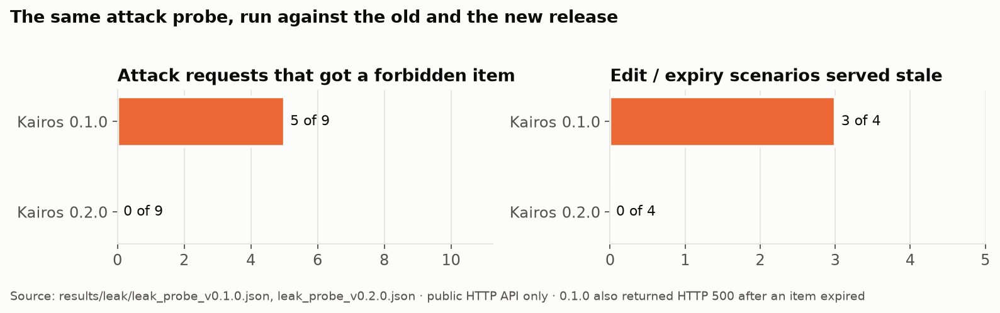
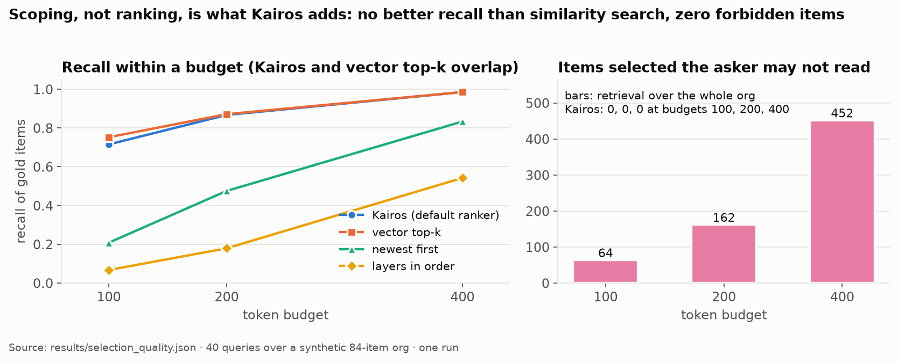
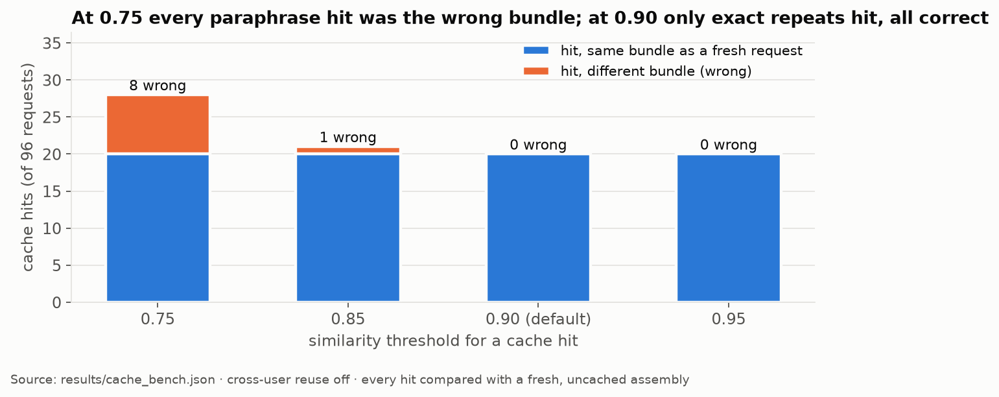
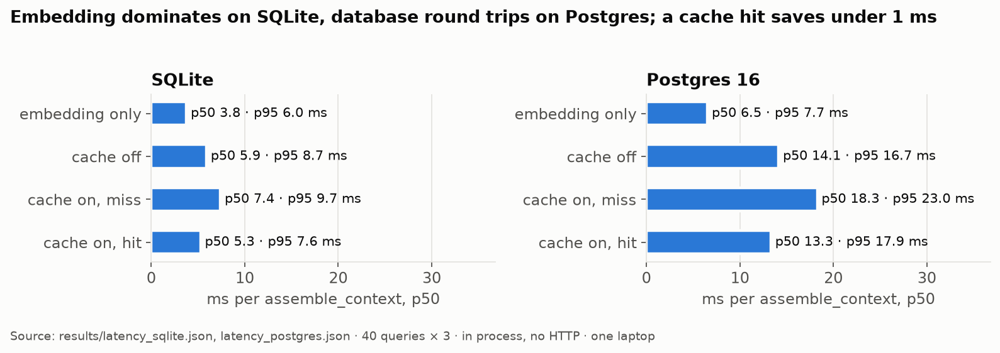

# Kairos

**It gives a coding agent the org, team, project, personal and session knowledge that applies to its task, ranked and cut to a token budget, and never anything the person behind the agent is not allowed to read.**

Coding agents start every task without the context a colleague would have: the org's standards, the team's conventions, the project's past decisions, your own preferences, what you were doing in this session. The usual fix is a hand-kept `CLAUDE.md` that is pasted in whole. Kairos keeps that knowledge in layers, works out which layers the caller may read, and returns only the part relevant to the task, within a budget.

```
kairos try "Add a /healthz endpoint to a new internal service" --session session-0 --budget 120

As: person-team-platform-0   scope: org:org-1 > team:team-platform > project:proj-orchestrator-core > personal:person-team-platform-0 > session:session-0
  [org] Every service needs a health check endpoint at /healthz.
  [org] All services must expose a /healthz endpoint for readiness checks.
  [team] We migrated infra provisioning to Terraform; no manual console changes.
  [session] Working notes: the new service is ledger-sync; its readiness probe must also check Kafka consumer lag.
  [project] Orchestrator Core uses Kafka as its event backbone because it needed replay support that SQS lacked.
  [personal] Hana: Prefers pairing on architecture decisions rather than async docs.
114/120 tokens, cache miss, dropped [{'layer': 'org', 'count': 1, 'reason': 'budget'}, {'layer': 'team', 'count': 1, 'reason': 'budget'}]
```

**Status: alpha (0.2).** Measured on synthetic data only, including where it falls short. The API may change. See [Limits](#limits).

- [How it works](#how-it-works)
- [Install](#install) and [Quickstart](#quickstart)
- [Why it is safe](#why-it-is-safe)
- [Evidence](#evidence)
- [What you get](#what-you-get)
- [Limits](#limits)
- [Guides](#guides), [Reproduce](#reproduce), [Repository layout](#repository-layout)

## How it works

1. **A request arrives** from an agent (through MCP, the HTTP API or the CLI) with a credential, a task description and a token budget.
2. **The scope is resolved from the credential, not the request.** A key is bound to one person. Kairos walks the directory: the org, the person's own team, the project (only if the person's team owns it), the person, and the session (only if it is theirs). Anything else the request names is refused or left out with a note.
3. **Candidates are retrieved** from those scopes only, and only facts valid now (superseded facts keep their history but are never served). Each gets its similarity to the task.
4. **Candidates are ranked**: similarity × confidence × graph centrality × freshness, with a boost for the caller's own notes.
5. **The budget is filled** greedily. The first item that does not fit is compressed into the remaining space or dropped. Every drop is reported by layer and reason.
6. **The bundle is cached** in a partition that only an identical caller with identical readable knowledge can ever reach, and re-checked item by item before it is served again.

Each stage is a small interface ([kairos/pipeline/types.py](kairos/pipeline/types.py)) that can be replaced on its own. The benchmarks use that to plug in baselines. Details: [architecture](docs/architecture.md), [concepts](docs/guide/concepts.md).

## Install

```bash
git clone https://github.com/Dharan1729/kairos && cd kairos
python -m venv .venv && . .venv/bin/activate
pip install -e .                 # add ".[postgres]" for Postgres, ".[dev]" for tests
```

Python 3.11 or later. The install pulls in `sentence-transformers` (and so PyTorch), about 1 GB. On first use the embedding model `all-MiniLM-L6-v2` (about 90 MB) is downloaded from Hugging Face into `~/.cache/huggingface`; after that, nothing leaves your machine unless you turn on LLM compression ([configuration](docs/guide/configuration.md)).

## Quickstart

One command, no Docker, SQLite in `./.kairos/`:

```bash
kairos quickstart
```

It loads the synthetic demo org (`kairos/demo_data/`, generated by `knowledge-layer/`; 16 people in 4 teams), writes two dev keys to `.kairos/dev_keys.json` (an admin service key and a key bound to the demo user), prints a sample bundle and serves the API on `127.0.0.1:8000`. In another shell:

```bash
export KAIROS_URL=http://127.0.0.1:8000
export KAIROS_API_KEY=$(python -c "import json;print(json.load(open('.kairos/dev_keys.json'))['demo_user'])")
kairos assemble --task "Set up Terraform for a new service" --budget 300
kairos try "Investigate the perception model latency" --user person-team-ml-2   # local, no server
```

Use it from Claude Code (stdio MCP server, details and Cursor in [docs/guide/mcp.md](docs/guide/mcp.md)):

```bash
claude mcp add kairos --env KAIROS_URL=http://127.0.0.1:8000 --env KAIROS_API_KEY=<a person-bound key> -- kairos-mcp
```

Postgres and Docker: `KAIROS_HTTP_PORT=8000 docker compose up -d --build`, then `docker compose exec kairos kairos seed`. See [deployment](docs/guide/deployment.md).

## Why it is safe

The risky parts are who the context is for, and reusing a bundle built for someone else. Both are decided by code from the credential and the directory, never from fields the caller supplies.

- **A key acts as one person.** Keys (and SSO tokens, through a configurable claim) are bound to a person in the directory. A request that names another user is refused (403), not quietly corrected. An unbound admin key is a gateway credential that may act for any person in its tenant; any other unbound key gets the org layer only.
- **Scopes are derived, then checked.** The team is the person's own team. A project counts only if that team owns it. A session counts only if it belongs to the person; naming someone else's session is refused. An unknown user gets the org layer only. Every write checks the same rules, and the item's layer must match the kind of scope, so a private note can never be filed under a shared scope.
- **The cache cannot cross a permission boundary.** A bundle is stored under a partition key that hashes the tenant, the caller's full scope chain, the caller's identity, the id and version of every item the caller can read, the budget and the embedder. Similarity is only compared inside one partition. Personal and session knowledge is never shared: with optional cross-user reuse on, two users share a bundle only if neither has any private items in play and their shared scopes are identical.
- **Nothing stale is served.** Any write to a readable scope, an edit, a supersession or an expiry changes the partition. On every hit each item in the bundle is re-read and must still exist, be valid, be readable by this caller and have the same content hash. This also catches edits made directly in SQL.
- **Fail closed.** Unknown scope ids are treated as another tenant's. Ids of other tenants' candidates, items and keys return the same 404 as missing ones.

What Kairos does not protect against is in [SECURITY.md](SECURITY.md).

## Evidence

Everything here comes from [docs/benchmarks.md](docs/benchmarks.md), where the method and limits are written up, and can be reproduced with one command each. Data is synthetic. One run each, on one laptop (Apple M4 Pro, CPU only), with the default local embedding model.

**The cache leak, before and after.** The leak probe sends adversarial requests over the HTTP API after the victim has warmed the cache. It was run unchanged against the previous code (0.1.0) and this release.

| | 0.1.0 | 0.2.0 |
|---|---|---|
| Attack requests that received an item the caller may not read | **5 of 9** | **0 of 9** (5 refused with 403, 4 answered without it) |
| Distinct forbidden items served | 4 (a colleague's personal note, 3 of another team's items) | 0 |
| Change scenarios that served stale content (ORM edit, SQL edit, expiry, supersession) | **3 of 4** | **0 of 4** |
| Uncached request after an item expired | HTTP 500 | 200 |



The 0.1.0 cache did key on the resolved scopes. The leak came from what fed it: scope resolution trusted the `user_id`, `session_id` and `repo` in the request, with no ownership or team check, so one tenant-wide key could resolve to anyone's scopes, and the cache then served those bundles again. Staleness came from keying on a per-scope version counter that in-place edits and expiry did not change. Both are fixed by construction above and pinned by [tests/test_cache_safety.py](tests/test_cache_safety.py).

**Context selection.** 20 labelled tasks, each asked in two phrasings (40 queries), against 84 items in a synthetic 3-team org. Mean 2.65 relevant items per task. "Dump all layers" (everything the caller can read) averages 518 tokens.

| Method, budget 200 tokens | Precision | Recall | Tokens | Forbidden items |
|---|---|---|---|---|
| **Kairos (default)** | 0.20 | **0.87** | 197 | 0 |
| Vector top-k (similarity only) | 0.20 | 0.87 | 196 | 0 |
| Recency (newest first) | 0.12 | 0.48 | 198 | 0 |
| Dump layers in order, cut at budget | 0.03 | 0.18 | 199 | 0 |
| Kairos with a 0.30 similarity floor | **0.53** | 0.57 | **62** | 0 |
| Similarity over the whole org, no scoping | 0.18 | 0.83 | 198 | **162** |



- **The ranker does not beat plain similarity here.** Kairos and vector top-k are within 0.01 at every budget; the graph-centrality factor slightly hurts (recall 0.71 vs 0.75 at 100 tokens). The extra factors have nothing to work with when every item has the same confidence and freshness, as in this dataset. What does the work is scoping and the budgeter.
- **Budgets are kept.** 0 of 840 bundles exceeded the budget (by Kairos's 4-characters-per-token estimate).
- **Token savings against dumping every readable layer:** 62% fewer tokens at 200 for recall 0.87; 24% fewer at 400 for recall 0.98. With the similarity floor, 88% fewer for recall 0.57.
- **Scoping is what stops leaks:** retrieving over the whole org selected 162 forbidden items (other people's notes, other teams' facts, superseded facts) at 200 tokens, and recall was lower too.

**Cache.** Same tasks; the owner repeats each task, then paraphrases it, then a teammate and two new hires ask it.

| Similarity threshold | Hit rate | Paraphrase hits | Hits that differed from a fresh assembly | Leaks |
|---|---|---|---|---|
| 0.75 (0.1.0's value) | 0.29 | 8 of 20 | **8 of 28** | 0 |
| 0.85 | 0.22 | 1 of 20 | 1 of 21 | 0 |
| **0.90 (default)** | 0.21 | 0 of 20 | **0** | 0 |
| 0.90, cross-user reuse on | 0.29 | 0 of 20 | 0 | 0 |



- At 0.75, every paraphrase hit served a bundle different from the one the request would have got. The default is now 0.90: exact repeats hit, paraphrases do not.
- **The cache saves little time at this scale:** median 6.8 ms on a hit against 8.0 ms on a miss, because the task embedding (median 3.8 ms) is computed before the lookup. Its value is consistency and fewer database reads, not latency.

**Latency** of `assemble_context` in process, 120 requests per row:

| | SQLite p50 / p95 | Postgres 16 p50 / p95 |
|---|---|---|
| Cache off | 5.9 / 8.7 ms | 14.1 / 16.7 ms |
| Cache on, miss (includes store) | 7.4 / 9.7 ms | 18.3 / 23.0 ms |
| Cache on, hit | 5.3 / 7.6 ms | 13.3 / 17.9 ms |
| Embedding alone | 3.8 / 6.0 ms | 6.5 / 7.7 ms |



## What you get

| | |
|---|---|
| **Five knowledge layers** | Org, team, project, personal, session. Bi-temporal facts: superseded ones are kept and never served. |
| **One core call** | `ContextService.assemble()`: scope, retrieve, rank, budget, cache, audit. HTTP API, MCP server and CLI are thin adapters. |
| **Swappable stages** | Scope resolver, retriever, ranker, budgeter and cache behind small protocols. |
| **Permission-safe cache** | Scope-partitioned, validated on every hit, cross-user reuse off by default. |
| **MCP server** | `get_context`, `search`, `remember` for Claude Code, Cursor and any MCP client. `remember` only proposes. |
| **Human review** | Agents and members propose facts; an admin approves them before they are served. |
| **Access control** | Person-bound API keys, per-tenant SSO (JWT/JWKS), viewer/member/admin roles, tenant isolation tested on every endpoint and MCP tool. |
| **Operations** | SQLite or Postgres with Alembic migrations, Docker image (non-root, health check), per-tenant rate limits, OpenTelemetry tracing, audit ledger and dashboard, backup scripts. |
| **Ingestion** | Manual facts, git commit extraction, a watcher that re-extracts on new commits, optional LLM summaries. |

## Limits

- **Synthetic data only.** Every number above is from data the same author wrote, with the bias that implies. Nothing has been measured on a real organization's knowledge.
- **Ranking is no better than similarity on this data.** The confidence, freshness and graph factors are unproven; graph centrality slightly hurt. A relevance floor trades recall for precision and is off by default.
- **Paraphrases do not hit the cache at the default threshold.** That is the price of not serving a bundle built for a different task.
- **Project access is team ownership only.** There are no per-project memberships, so a contributor from another team cannot be given a project's context yet.
- **Token counts are estimated** at 4 characters per token, not with the target model's tokenizer.
- **The directory is not managed through the API.** Orgs, teams, people, projects and sessions are loaded by `kairos seed` or your own sync job.
- **Single process.** The ANN index cache and rate-limit counters are in memory; with several replicas each keeps its own. Kairos does not terminate TLS.
- Alpha: expect API changes. The benchmarks are single runs.

## Guides

- [Quickstart](docs/guide/quickstart.md)
- [Concepts](docs/guide/concepts.md): layers, scope resolution, the context principal, who is asking
- [Configuration reference](docs/guide/configuration.md)
- [MCP setup for Claude Code and Cursor](docs/guide/mcp.md)
- [HTTP API](docs/guide/api.md)
- [Caching and its safety rules](docs/guide/caching.md)
- [Deployment](docs/guide/deployment.md) and [operations](docs/guide/operations.md)
- [Architecture and decisions](docs/architecture.md), [benchmarks](docs/benchmarks.md), [prior art](docs/prior-art.md)
- [Changelog](CHANGELOG.md), [Security](SECURITY.md), [Contributing](CONTRIBUTING.md)

## Reproduce

```bash
pip install -e ".[dev]"
bash scripts/reproduce.sh quick       # lint, types, 171 tests, leak probe
bash scripts/reproduce.sh bench       # selection quality, cache, SQLite latency
bash scripts/reproduce.sh postgres    # Postgres in Docker on 127.0.0.1:55439: migrations, tests, latency
```

| Claim | How to check | Committed result |
|---|---|---|
| 0 leaks and 0 stale bundles in 0.2.0 | `python -m benchmarks.leak_probe` | [results/leak/leak_probe_v0.2.0.json](results/leak/leak_probe_v0.2.0.json) |
| 5 of 9 leaking requests in 0.1.0 | `python benchmarks/leak_probe.py --src <0.1.0 checkout>` | [results/leak/leak_probe_v0.1.0.json](results/leak/leak_probe_v0.1.0.json) |
| Selection quality table | `python -m benchmarks.selection_quality` | [results/selection_quality.json](results/selection_quality.json) |
| Cache table | `python -m benchmarks.cache_bench` | [results/cache_bench.json](results/cache_bench.json) |
| Latency table | `python -m benchmarks.latency [--database-url ...]` | [results/latency_sqlite.json](results/latency_sqlite.json), [results/latency_postgres.json](results/latency_postgres.json) |
| Safety rules hold | `pytest tests/test_cache_safety.py tests/test_tenant_isolation.py` | CI |
| Figures | `pip install matplotlib && python -m benchmarks.plots` (reads only the committed results) | [results/figures/](results/figures/) |

Benchmarks write to `out/` and never overwrite `results/`. Counts reproduce exactly with the same embedding model; latency depends on your machine. The 0.1.0 code is not part of this repository's history; its result is committed as measured.

## Repository layout

```
kairos/            the service
  pipeline/        types.py (stage protocols), scope.py, retrieval.py, ranking.py, budget.py, cache.py, service.py
  access.py        who is asking; read and write rules
  api.py cli.py mcp_server.py   adapters
  knowledge.py     writes: items, supersession, proposals, git extraction
  models.py directory.py db.py config.py embeddings.py graph.py vector_index.py
  auth.py sso.py ratelimit.py telemetry.py dashboard.py llm.py seed.py watch.py
alembic/           migrations
knowledge-layer/   the synthetic demo org and its generator
benchmarks/        dataset.py (labelled benchmark org) and one script per benchmark
results/           committed benchmark results
tests/             unit and integration tests (SQLite by default, Postgres with KAIROS_TEST_DATABASE_URL)
docs/              guides, architecture, benchmarks, prior art
```

## Third-party notes

- **Embedding model.** `sentence-transformers/all-MiniLM-L6-v2` (Apache-2.0) is downloaded from Hugging Face on first use. It is not bundled.
- **Optional LLM compression** sends knowledge content to Anthropic or OpenAI, only when `KAIROS_LLM_PROVIDER` is set. Off by default.
- **Ideas from other projects** (Zep/Graphiti, Aider, Letta, CodeGraph and others) are credited in [docs/prior-art.md](docs/prior-art.md). No code was copied.
- **The demo and benchmark orgs are fictional.** Names are generated first names; any resemblance to real people or companies is accidental.

## License

Apache-2.0. See [LICENSE](LICENSE).
