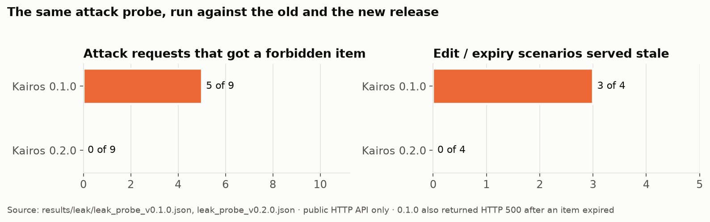
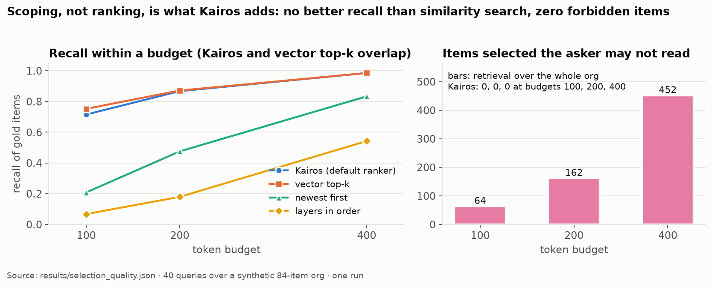
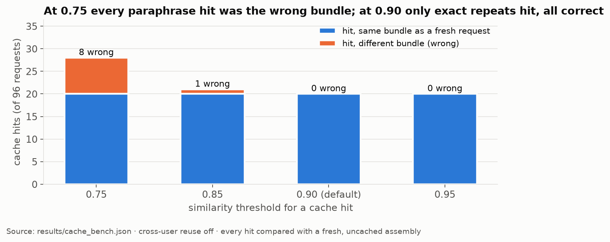
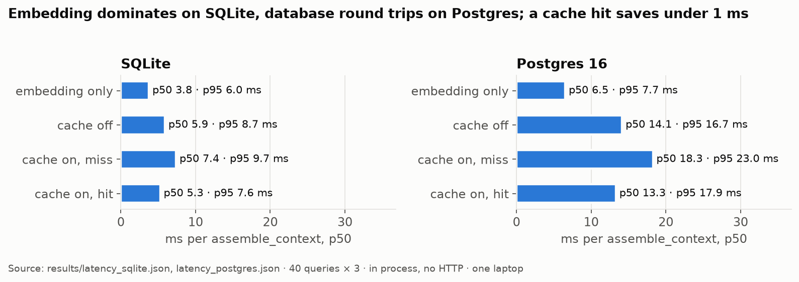

# Benchmarks

> **Reading this log.** Every entry gives the question, the setup, the command, the numbers and what they do and do not show. Results that go against Kairos are kept. All runs are single runs on synthetic data written by the same author as the code; treat them as evidence about mechanisms, not about real organizations.

**Environment** (all entries): Kairos 0.2.0, Python 3.11.8, macOS on Apple M4 Pro, CPU only. Embedding model `sentence-transformers/all-MiniLM-L6-v2` via sentence-transformers. SQLite (bundled) and Postgres 16 (`postgres:16-alpine` in Docker on the same machine). SQLAlchemy 2.1, numpy 2.4. Exact versions are recorded in each result file.

**Reproduce**: each entry names its command. Scripts write to `out/`; committed copies are in `results/`. Counts reproduce exactly with the same embedding model; times depend on the machine.

---

## BENCH-001 — Leak and staleness probe

**Question.** Can a caller obtain context belonging to another user or another team, directly or through the cache? Does the cache serve content that has changed?

**Method.** [benchmarks/leak_probe.py](../benchmarks/leak_probe.py) seeds the demo org, lets the victim warm the cache, then sends attack requests over the HTTP API (FastAPI test client) and counts responses that contain items the attacker may not read. It then changes an item that is in a cached bundle in four ways and checks whether the old content is served again. The probe uses only the public API and direct database edits, so it runs unchanged against another source tree.

Attacker credentials are what each version offers: 0.1.0 has only tenant-wide keys, so the attacker uses one; 0.2.0 binds keys to people, so the attacker uses a key bound to themselves.

Scenarios (victim A = `person-team-platform-0`, attacker B = a teammate, ML = a member of another team):

| Scenario | Request |
|---|---|
| session_hijack | B names A's session id (with and without `user_id`) |
| user_spoof | B sends `user_id = A` (with and without A's repo) |
| same_project_cache_reuse | B asks A's exact task on the same project, with B's own session and with the repo |
| cross_team_repo | ML names team-platform's repo |
| unknown_user_repo | ML sends a user id that is not in the directory plus team-platform's repo |
| orm_in_place_edit / raw_sql_edit / expired_item / superseded_via_api | a bundled item is changed, then the victim repeats the request |
| fresh_request_after_expiry | after the expiry, a different (uncached) task |

**Commands.**

```bash
python -m benchmarks.leak_probe --label v0.2.0
python benchmarks/leak_probe.py --src <checkout of 0.1.0> --label v0.1.0   # run from outside the repo, python -I
```

**Results** ([0.1.0](../results/leak/leak_probe_v0.1.0.json), [0.2.0](../results/leak/leak_probe_v0.2.0.json)):

| | 0.1.0 | 0.2.0 |
|---|---|---|
| Attack requests | 9 | 9 |
| ...that received a forbidden item | **5** | **0** |
| ...refused (403 or 422) | 2 | 5 |
| Distinct forbidden items served | 4 | 0 |
| Staleness scenarios serving old content | **3 of 4** | **0 of 4** |
| Uncached request after an expiry | **HTTP 500** | 200 |

Per scenario on 0.1.0: session_hijack 1 of 2 leaked A's personal note (one request was a cache hit on A's bundle); user_spoof 2 of 2; same_project_cache_reuse 0 of 2; cross_team_repo 1 of 2 and unknown_user_repo 1 of 1 served three team-platform items each. ORM edit, SQL edit and expiry were all served stale as `assembly_hit`; supersession through the API was handled correctly (the version counter moved).

**Interpretation.** The 0.1.0 cache key did contain the resolved scopes, so it never mixed two *correctly resolved* users. The leaks came from resolution: the scope chain was built from `user_id`, `session_id` and `repo` in the request body with no check that the session or repo belonged to the caller, and every key was tenant-wide. The cache then replayed those bundles (2 of the 5 leaking requests were cache hits). Staleness came from the cache key using a per-scope maximum version that in-place edits and expiry do not change. The 500 is the same root cause in the ANN index cache: an expired item stayed in the cached index and the lookup failed (`KeyError`).

0.2.0 removes each cause rather than filtering outputs: identity from the credential, team and project from the directory, a partition key over every readable item's version, and a content re-check on hit. `same_project_cache_reuse` shows the remaining risk surface is closed even for a legitimate teammate with an identical task.

**Limits.** Nine attack requests and four change scenarios on a 32-item demo org. They target the failure modes found by reading the code; they are not a fuzzing campaign. CI runs the probe on every push and fails on any leak.



---

## BENCH-002 — Context-selection quality

**Question.** Within a token budget, does Kairos pick the knowledge a task needs, compared with simple alternatives?

**Data.** [benchmarks/dataset.py](../benchmarks/dataset.py): a hand-written fictional company with 3 teams, 6 projects and 9 people. 84 items: 45 topic facts across org, team and project layers, 20 filler facts that are true but irrelevant to every task, 4 superseded facts, 12 personal notes and 3 session notes. 20 tasks, each with a canonical phrasing and a paraphrase (40 queries). The gold set for a task is computed from rules: every valid fact of the task's topic in a scope the asker can read, plus personal or session notes tagged for that task. Mean 2.65 gold items per task. Some topics have look-alike facts in other teams' scopes (unreadable for the asker) and superseded versions.

**Method.** Every method runs through the real `ContextService` (cache off) with the same `GreedyBudgeter` (no LLM: compression is truncation). Only the stage under test changes. An item counts as selected if it appears in the bundle, whole or compressed. Precision = selected gold / selected; recall = selected gold / gold; averaged over 40 queries. Budgets 100, 200, 400 tokens (Kairos's 4-characters-per-token estimate). "Dump all relevant layers" (every readable, valid item, unbudgeted) averages 518 tokens (467 to 568).

| Method | What changes |
|---|---|
| kairos | default ranker: similarity × confidence × graph centrality × freshness × personal boost |
| kairos_floor | default ranker, items below similarity 0.30 dropped |
| kairos_no_graph | default ranker without graph centrality |
| vector_topk | similarity only |
| recency | newest first, task ignored |
| dump_layers | org, team, project, personal, session in insertion order, cut at the budget |
| whole_org_vector | similarity over every scope in the org and superseded facts too (no scope resolution, no validity filter) |

**Command.** `python -m benchmarks.selection_quality` ([result](../results/selection_quality.json), per-query detail included).

**Results.**

| Method | P@100 | R@100 | P@200 | R@200 | P@400 | R@400 | Forbidden selected @100 / 200 / 400 |
|---|---|---|---|---|---|---|---|
| kairos | 0.34 | 0.71 | 0.20 | 0.87 | 0.11 | 0.98 | 0 / 0 / 0 |
| kairos_floor (mean 56 / 62 / 62 tokens) | **0.54** | 0.55 | **0.53** | 0.57 | **0.53** | 0.57 | 0 / 0 / 0 |
| kairos_no_graph | 0.35 | 0.75 | 0.20 | 0.88 | 0.11 | 0.98 | 0 / 0 / 0 |
| vector_topk | 0.35 | 0.75 | 0.20 | 0.87 | 0.11 | 0.98 | 0 / 0 / 0 |
| recency | 0.10 | 0.21 | 0.12 | 0.48 | 0.10 | 0.83 | 0 / 0 / 0 |
| dump_layers | 0.03 | 0.07 | 0.03 | 0.18 | 0.06 | 0.54 | 0 / 0 / 0 |
| whole_org_vector | 0.29 | 0.67 | 0.18 | 0.83 | 0.10 | 0.96 | **64 / 162 / 452** |

Budget adherence: 0 of 840 bundles exceeded their budget; the largest was exactly at the budget.



Token savings against dumping every readable layer (518 tokens): at 200 tokens Kairos keeps 0.87 of the gold items with 62% fewer tokens; at 400, 0.98 with 24% fewer; with the floor, 0.57 with 88% fewer.

**Interpretation.**

- **The weighted ranker adds nothing over plain similarity on this data, and graph centrality slightly hurts** (recall 0.71 vs 0.75 at 100 tokens). In this dataset every item has the same confidence and staleness hint, so those factors are constant; centrality rewards items that have near-duplicates in their scope, which is not the same as relevance. A dataset with varied provenance might show a difference; this one does not, and we have not run one that does.
- **Scope resolution matters most.** Retrieval over the whole org selected 64 to 452 items the asker may not read (other people's notes, other teams' look-alikes, superseded facts), and its recall was lower because those items displaced readable gold.
- **Order-only baselines are poor.** Concatenating layers in order, as a hand-built context file does, finds 18% of the gold at 200 tokens.
- **A similarity floor trades recall for precision.** At 0.30 it stops at about 62 tokens with precision 0.53 and recall 0.57. It is available (`WeightedRanker(min_similarity=...)`) but off by default, because missing a relevant fact is usually worse for an agent than reading a few extra lines.

**Limits.** One author wrote the facts, the tasks and the ranker; the tasks name their topic in words close to the facts, which favours similarity-based methods. Gold is topical relevance, not usefulness to a model, and no downstream task success was measured. Precision is low at large budgets for every method by construction: with ~2.65 gold items, filling 400 tokens must include non-gold items. One run, one embedding model.

---

## BENCH-003 — Bundle cache: hit rate, fidelity, latency, leaks

**Question.** How often does the scope-partitioned cache hit, are hits correct, and what does it save?

**Method.** [benchmarks/cache_bench.py](../benchmarks/cache_bench.py) on the BENCH-002 org, budget 200. For each of the 20 tasks: the owner asks it (first), asks it again (repeat), asks the paraphrase, a teammate on the same project asks it, and, for the 8 Payments tasks, two new hires with no personal notes ask it (96 requests). Every hit is compared with a fresh, uncached assembly of the same request: a hit "differs" if the item list is not identical. Every response is checked for items outside the caller's scopes. Runs: cache off; thresholds 0.75, 0.85, 0.90, 0.95 with cross-user reuse off; 0.90 with cross-user reuse on.

**Command.** `python -m benchmarks.cache_bench` ([result](../results/cache_bench.json)).

**Results.**

| Config | Hit rate | Repeat | Paraphrase | Teammate | New hires | Hits differing from fresh | Leaks | Hit p50 | Miss p50 |
|---|---|---|---|---|---|---|---|---|---|
| cache off | 0 | | | | | | 0 | | 7.2 ms |
| 0.75 | 0.29 | 20/20 | 8/20 | 0/20 | 0/16 | **8 of 28** | 0 | 6.4 ms | 8.0 ms |
| 0.85 | 0.22 | 20/20 | 1/20 | 0/20 | 0/16 | 1 of 21 | 0 | 6.6 ms | 8.0 ms |
| **0.90 (default)** | 0.21 | 20/20 | 0/20 | 0/20 | 0/16 | **0** | 0 | 6.8 ms | 8.0 ms |
| 0.95 | 0.21 | 20/20 | 0/20 | 0/20 | 0/16 | 0 | 0 | 6.5 ms | 7.1 ms |
| 0.90, cross-user on | 0.29 | 20/20 | 0/20 | 0/20 | 8/16 | 0 | 0 | 5.7 ms | 7.7 ms |



**Interpretation.**

- **A loose threshold serves the wrong bundle.** At 0.75 (the 0.1.0 default) all 8 paraphrase hits returned a bundle that differs from what the paraphrased request would have got. They were not leaks (same caller, same scopes), but they were wrong. The default is now 0.90; paraphrases do not hit.
- **Partitioning works as designed.** Teammates never hit (each has personal notes, so their readable knowledge differs). With cross-user reuse on, the second new hire hit on the first one's bundle in all 8 cases, with zero differences. No configuration leaked.
- **The cache barely saves time here.** A hit is about 1.2 ms faster at the median, because embedding the task (about 4 ms) happens before the lookup and dominates. Its value is returning the same bundle for the same request; embedding before the lookup is required to compare tasks at all.

**Limits.** The workload is constructed, not sampled from real traffic; real hit rates depend on how often people repeat requests exactly. Single run; latencies on one machine.

---

## BENCH-004 — assemble_context latency on SQLite and Postgres

**Method.** [benchmarks/latency.py](../benchmarks/latency.py): the 40 BENCH-002 queries, 3 repetitions, budget 400, in process (no HTTP). For each query: the embedding alone; cache off; cache on and first seen (miss, includes the store); the same again (hit). Postgres 16 ran in Docker on the same laptop, over localhost.

**Commands.** `python -m benchmarks.latency`; `python -m benchmarks.latency --database-url postgresql://...` (or `bash scripts/reproduce.sh postgres`). Results: [SQLite](../results/latency_sqlite.json), [Postgres](../results/latency_postgres.json).

| n = 120 each | SQLite p50 | SQLite p95 | Postgres p50 | Postgres p95 |
|---|---|---|---|---|
| Embedding only | 3.8 ms | 6.0 ms | 6.5 ms | 7.7 ms |
| Cache off | 5.9 ms | 8.7 ms | 14.1 ms | 16.7 ms |
| Cache on, miss | 7.4 ms | 9.7 ms | 18.3 ms | 23.0 ms |
| Cache on, hit | 5.3 ms | 7.6 ms | 13.3 ms | 17.9 ms |



**Interpretation.** At this size the embedding is the largest single cost on SQLite. Postgres adds about 8 ms of round trips per request (each request makes several small queries: directory lookups, the readable-version query, retrieval, the audit insert); a cache miss adds the store. Embedding was also slower during the Postgres run, which suggests some contention from the database container on the same machine.

**Limits.** 84 items. Larger scopes add retrieval and ranking cost roughly linearly until the ANN top-k (500) caps it; not measured. No concurrency, no HTTP overhead, one machine.

---

## Earlier work not reproduced here

Before 0.2.0, the cache similarity threshold (0.75) was set from experiments with external semantic caches (GPTCache, RedisVL) on single-sentence paraphrase pairs. Those scripts were exploratory, depended on external services and are not included. BENCH-003 replaces them with a measurement on Kairos's own bundles, and it reverses their conclusion for this use: 0.75 was too loose.
